# 跨省养老新手任务 UX 审核

**最新状态（最终保留草稿版，2026-10-12）：指定任务与定向回归无剩余已复现 P1/P2。金额示例现在保留跨省经历，局部独立计算；显式重新关联会清金额与确认，并恢复北京拒算及非整岁退休限制。** 详细证据见文末“最终版：示例保留经历定向验收”。前文“示例会清空经历”的文字与图片仅记录旧版及中间版，已被最终实现覆盖，不代表当前行为。

这是 AI 模拟低知识用户的独立审阅，不是真人可用性实验。仅通过独立 Chrome 标签操作 localhost:3000/#labor；先体验页面，没有读取实现或既有验收路径。已读 docs/DEVELOPMENT.md，未发现适用 AGENTS.md。未修改产品代码、stage、commit 或部署。

## 基线：改版前

日期：2026-10-12。虚构人物：1966-01 出生，经办确认原 60 岁普通企业职工类别；河北户籍；正式关系及当前参保省为浙江，均假定经办确认为普通关系；尚未领取，2026-10-12 已经办确认满足领取条件，无特殊事项。北京 2000-01—2011-12 核定 144 月，上海 2012-01—2021-12 核定 120 月，浙江（温州）2022-01—2026-05 核定 53 月，共 317 月。全部是审核用虚构前提，不是用户资料，也不是由工作日期推定实际月数。

实际路径：进入养老与缴费 → 阅读三步骤 → 填出生年月、317 月、确认类别 → 核对退休日期 → 填跨省基本情况和三段经历 → 核对领取省份 → 阅读下一张金额表的限制。未用任何一键示例。

操作量（不把自动化键盘分段误当用户点击）：1 次入口切换、2 次增加经历、2 次有效计算、4 次确认，共 9 次按钮/复选框操作；另有 21 个字段填写/选择。自动化 month fill 首次未写入，产生一次额外提交和“年月须为 YYYY-MM”；改用原生年月键盘输入成功，此自动化工具差异不计作产品 P1。跨省从开始到提交必须填 19 个字段并确认 3 项，才能看见领取省结果。

页面实际结果：退休年月 2026-05，60 岁 4 个月；最低 180 月，输入达到要求。领取省为上海，页面说明浙江不足 120 月，退回最后一个累计满 120 月的上海。结果可找到，结论与原因相邻；但被重复来源、免责、步骤卡和长段文字包围，需要继续滚动才能看金额入口。

金额任务停止点：页面显示仅上海、仅 2026 年固定情景，并在“退休年龄余月”旁解释非整周岁缺少适用计发月数依据即禁算。虚构人物是 60 岁 4 个月，页面没有提供本情景可用的计发月数；也没有已核定计发基数、平均缴费指数和个人账户额。因此没有用猜测值提交金额。新手需要自己把上一块的 60 岁 4 个月与下面的禁算提示关联；页首没有直接说明这个任务现在为什么不能继续。

### 发布阻断及建议

| 级别 | 观察证据 | 对新手的影响 | 建议验收标准 |
| --- | --- | --- | --- |
| P1 | 五张大表完整展开；三步骤只是文字；养老金金额、缴费支出、预算都在同一长页 | 不知道本任务要填哪些，易把缴费预算当退休金额准备 | 先按问题选择任务；只展开当前必需表，并显示清晰下一步 |
| P1 | 正式关系、普通/临时账户、核定实际月数要求已核实，提示主要是“查经办转移记录” | 不懂术语时无法形成可执行的资料准备清单；只能停在账户性质处 | 提供可直接问经办的问题、所需资料对应字段；未知保持未知，明确停止点而不诱导猜填 |
| P1 | 日期结果 60 岁 4 个月后，没有紧邻结果的“金额目前不能算”提示；到金额表才看到非整周岁限制 | 已算出退休和领取省仍以为只需填更多数字就能算金额 | 任务结论汇总明确分别展示日期、领取省、金额可算/不能算及原因 |
| P2 | 结果中同一官方链接重复多次，长免责声明和多张结果卡密集 | 结论存在，但视觉主次弱、阅读成本高 | 主要结论优先；推导、来源可展开查看 |
| P2 | “上海金额虚构示例”会重置上方领取判断，警告在长说明中 | 试着理解金额时可能失去刚完成的任务上下文 | 示例与本人任务分离，明确独立示例状态并保留已有任务 |
| P3 | 日期错误只说 YYYY-MM，与 Chrome 中文年月控件呈现不同 | 难知道是漏填还是格式错 | 用“请填写出生年月”且定位字段 |

### 基线证据

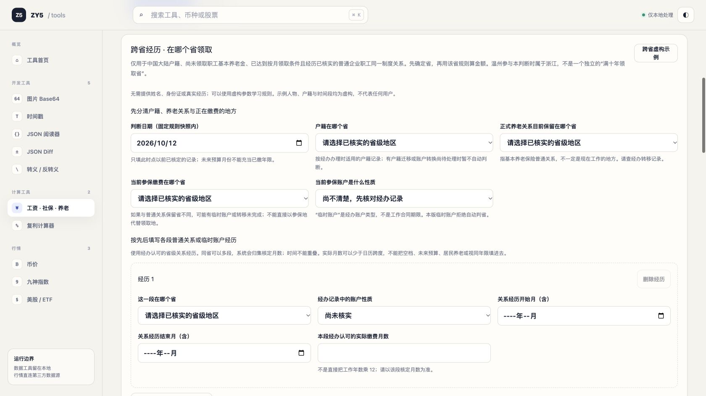

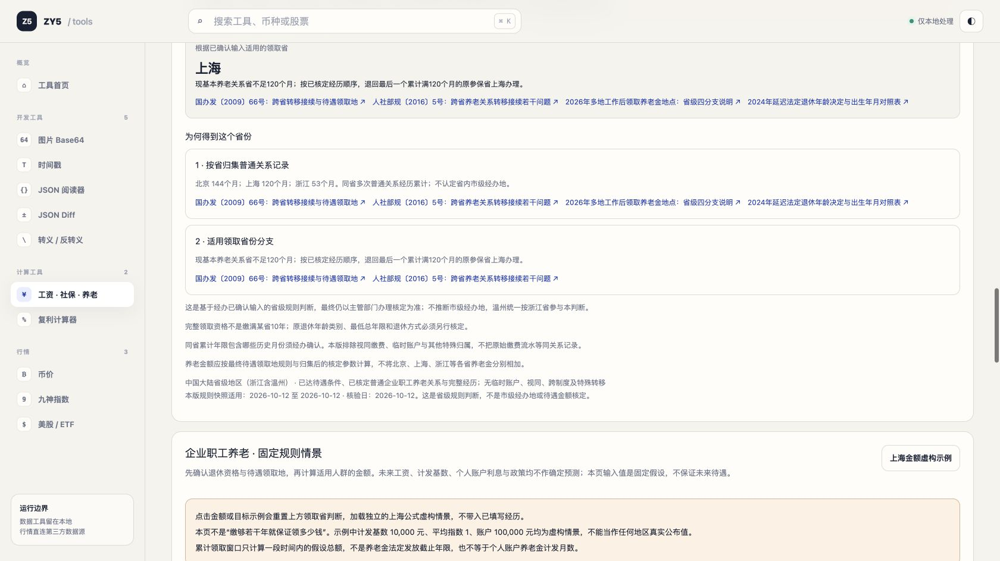

## 改版后复测

2026-10-12 在全新独立 Chrome 标签完成复测，仍未读取实现或实现者验收脚本。主任务仍使用上文完整虚构场景，未使用示例预填。

### 实际探索与结果

1. 从任务选择进入“养老金在哪个省领？”，点击“我不清楚，先看准备清单”。清单列出户籍、普通关系保留省、普通/临时账户、各段起止和核定月数、领取条件及特殊历史，并提供可直接问经办的一句话。空白继续被拦截，准确指出三个省份尚未核实。
2. 切换“什么时候能退休？”，填写 1966-01、原 60 岁、317 月，核实确认后得到 2026-05、60 岁 4 个月、最低 15 年。紧接结论明确说“不是整周岁……暂不能计算养老金金额。无需先填写金额参数”。
3. 使用“带入日期，继续查看养老金金额范围”自然继续；因领取省尚未判定，页面要求返回领取省任务，不开放金额表。返回后准备清单及原先状态保留。
4. 填三个省份后故意保留“账户不清楚”并继续，页面直接给出问经办的话：“我这里是普通基本养老关系，还是临时缴费账户？”停在第一步，没有诱导用 0 或猜值。
5. 使用明确虚构已核前提选择普通关系，进入第二步填写北京 144、上海 120、浙江 53 月三段、确认并计算。醒目结论为上海，解释“最后一个累计满 120 月”的顺序，不是最早北京或当前浙江。结果自动获得焦点，来源和详细路径可折叠。
6. 点击“下一步：查看上海金额支持范围”，金额页显示已带入 2026-05、60 岁 4 个月，并明确当前不支持，没有要求先填金额表。

操作数：上述真实探索过程共 16 次按钮/复选框操作，另 1 次任务切换，共 17 次非字段操作；填写/选择 22 个事实字段（退休类别不再默认替用户选择，因此比基线多 1 字段）。包含 2 次刻意验证未知资料的失败继续和 1 次打开准备清单；不含截图、键盘分段和下列回归检查。点击数没有变少，但任务边界、资料来源和失败原因可见，不能仅按少点击衡量可用性。

### 草稿、过期结果与十年顺序回归

- 跨任务返回时，三段经历、户籍/关系省、结果以及退休草稿保留。
- 上海实际月数由 120 改为 119：上海结论立即消失，3 个经办确认均清空；切换金额页明确“领取省判断需要更新”，未沿用上海。
- 对 119 月重新确认并计算：领取省为北京，同时明确“本版尚未开放北京金额计算，不能用上海公式代替”。这验证了两个都满十年时取最近上海、上海不满十年时回退北京的可见分支。
- 将退休任务的出生年月改为 1965-01：本任务的旧退休结果和确认立即消失。
- **初次复测发现 P2（后续已修复并复验）：已带入金额任务的退休日期未随来源变更标记过期。** 在上项修改后，把上海恢复为 120 月并重新判断，再进金额页，仍显示“刚才的退休日期……已带入 2026-05、60 岁 4 个月”。这已不是当前退休任务的已计算结果。当前情景仍被非整岁保护挡住，未观察到错误金额；但“刚才”与来源状态不一致。建议清除来自退休任务的预填，或标记“原条件已修改，重新计算后再带入”，不要把旧数据隐式当作独立情景。

### 原问题逐项结论

| 原级别/问题 | 新版结论 | 依据 |
| --- | --- | --- |
| P1 五张大表并列 | 已解决（本任务） | 任务式入口、当前任务单独显示、跨省分两步 |
| P1 不知道准备哪些经办资料 | 已解决（本任务） | 独立准备清单、账户未知的具体提问及停止点 |
| P1 非整岁日期与金额禁算未衔接 | 已解决（原任务） | 日期结果直接说明禁算；带入后隐藏金额表并列明 60 岁 4 个月 |
| P2 结果/重复规则视觉主次弱 | 已解决（本任务） | 突出上海与一句理由，详细路径折叠，结果自动聚焦 |
| P2 金额示例清空领取经历 | 最终已解决 | 最终版实际点击示例后完整经历保留；独立模式明确标识，重新关联清金额确认并恢复门禁。旧中间版的“明确清空”行为见历史记录 |
| P3 日期格式错误 | 本轮未复现，未据此宣称修复 | 采用原生年月输入完成，未把自动化 fill 差异算产品错误 |
| 新 P2 日期带入后来源变化仍显示旧值 | 修复后定向复测通过 | 见后续补测，修改与 reset 均触发明确过期阻断 |

初次改版复测发现上述新 P2；下述补测已验证修复。本轮原跨省新手任务及已复现问题目前无剩余 P1/P2 发布阻断。这个结论只覆盖指定任务和实际检查路径，不等同全功能、真人研究或养老金政策正确性的全面认证。

### 修复后定向补测

仍通过独立 Chrome 标签实操，未读实现。

1. 重新计算 1966-01 并显式带入 2026-05/60 岁 4 月；回退休任务改出生为 1965-01，再进金额任务。现在显示“退休条件已修改，原交接已失效”，说明旧日期、金额结果和核定确认不能继续使用，只有返回重算或明确清空独立情景两个入口；旧金额及确认控件不显示。
2. 点击返回退休任务，恢复 1966-01、重新确认计算，再显式带入。过期提示消失，重新显示正确的非整岁禁算说明。没有把过期阻断长期粘在新结果上。
3. 返回退休任务点击重置，再切金额。再次显示明确过期阻断，没有保留可用的旧交接。
4. 在上述状态实际点击“先看上海虚构示例”。点击前的一行提示明确说会清空领取省经历；点击后显示“当前是虚构示例”，结果标题也标注虚构，金额为 3,719.50。切回领取省，户籍、关系省、当前参保省和账户性质均恢复空白/未知，回到第一步，原三段草稿确实被重置。行为符合显式重置设计，不是承诺保留但暗中丢失；后续可考虑草稿恢复以减少重填成本。
5. 返回金额示例，将实际缴费月数 360 改为 361，示例结果立即消失，三项经办确认全部清空，不会继承示例的确认。

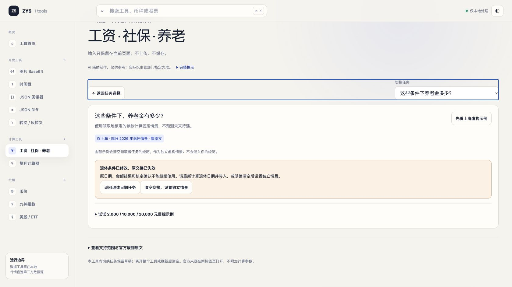

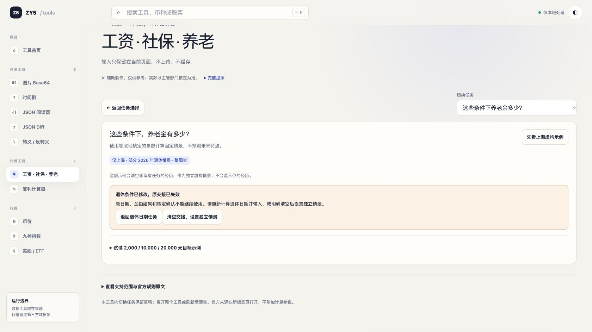

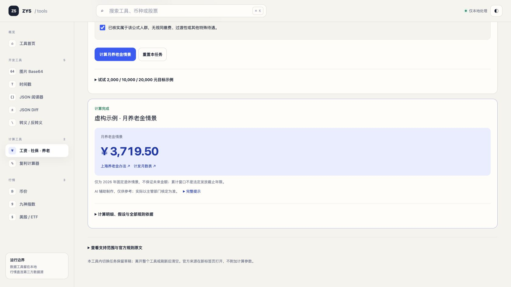

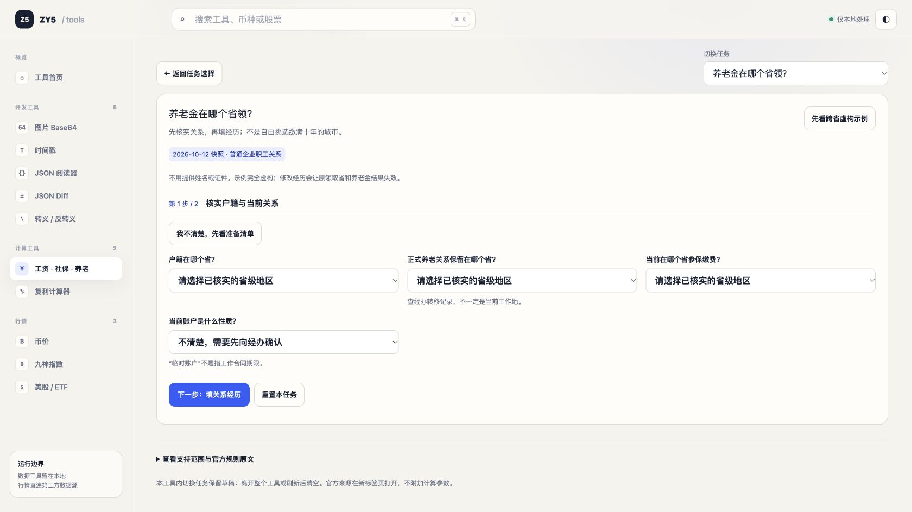

### 改版后证据

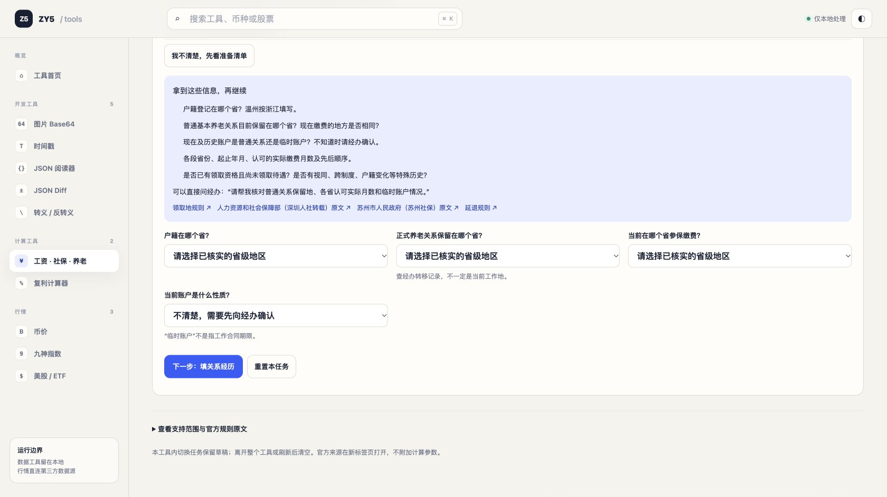

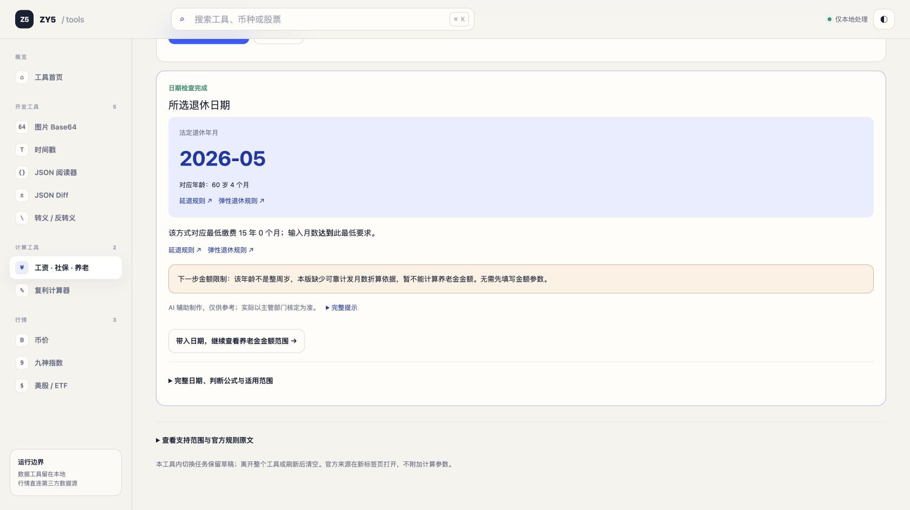

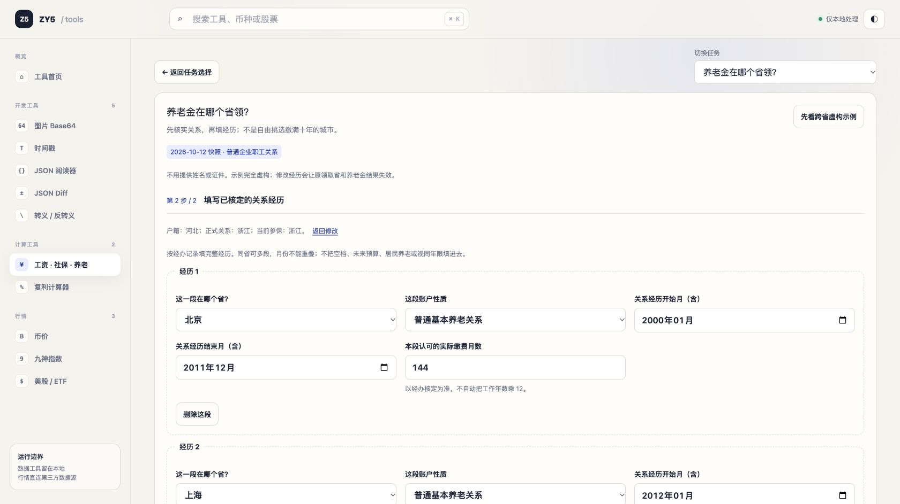

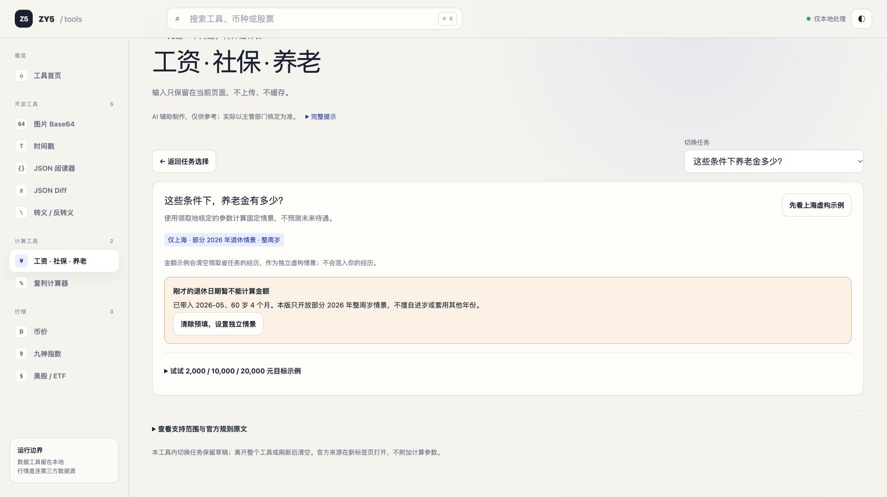

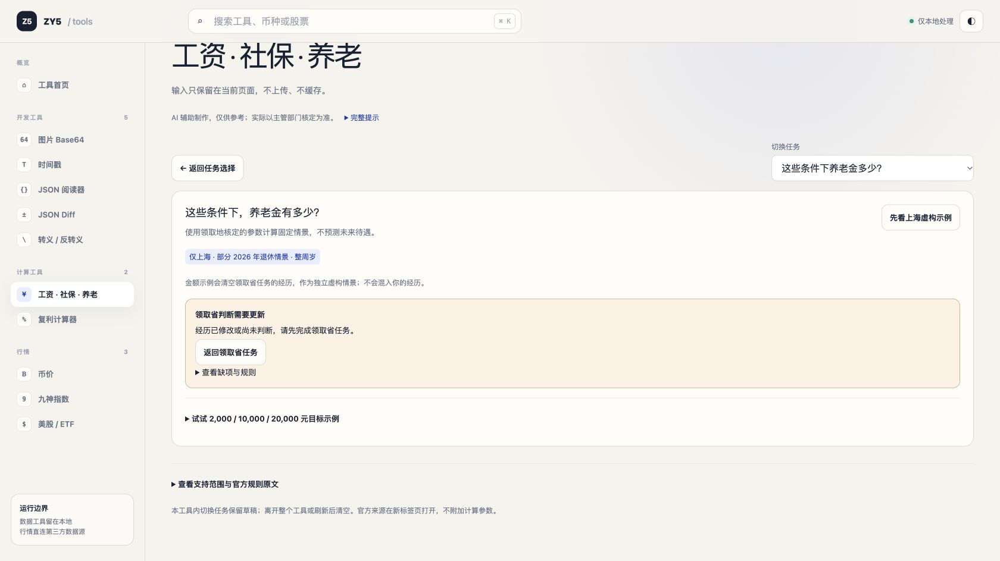

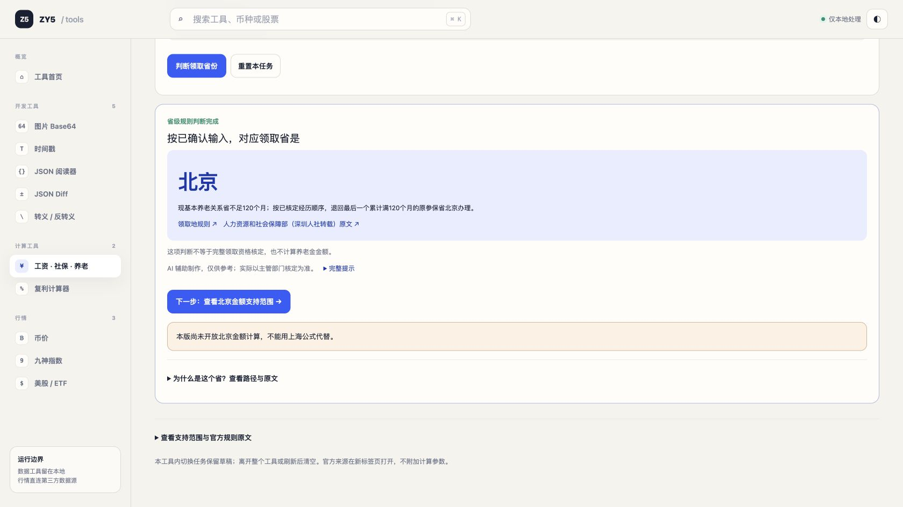

## 最终版：示例保留经历定向验收

另开全新独立 Chrome 标签，仅针对最后改动复测，没有重跑原三省主任务、没有读实现。这次用页面自带的**虚构跨省示例**作为可核对基线：江西户籍、普通关系及当前参保上海，北京 2010-01—2021-12 共 144 月，上海 2022-01—2024-12 共 36 月，结论北京。它仅用于状态隔离回归，不冒充原主任务的独立探索。

- **经历保留通过：** 先从北京结果进入金额任务得到拒算，再点上海虚构金额示例。切回领取省，户籍、关系省、两个时间段、账户性质、144/36 月和北京结果全部保留。
- **独立隔离通过：** 页面明确显示“独立上海情景 · 未使用已填领取省判断”“这里的金额不能作为该经历的待遇结论”，并给出“清空金额，重新关联已填领取省”。将跨省北京月数 144 改为 143 后，独立上海示例仍保持 3,719.50；没有把本人关系变化混入示例结果。
- **编辑示例通过：** 独立示例实际缴费月数 360 改为 361，结果立即消失，三个经办确认全取消。
- **重新关联北京通过：** 重放示例再点“清空金额，重新关联已填领取省”，因为跨省草稿有修改，先要求重新判断，原金额和确认不可用。143+36=179 月重新提交时被不足180月拒绝，恢复144并重新确认后得到北京；由结果下一步进入金额，明确“领取省为北京，本版不能代算金额”，没有沿用独立上海结果。
- **已清金额及确认的直接验证：** 在另一个明确虚构变体中将户籍改为上海、保留上海关系，重新判断为上海再进入金额。周岁、缴费月数、计发基数、平均指数、账户余额均空白，三个确认均未选，证明不是仅把旧值藏在北京禁算后面。
- **退休日期隔离通过：** 再计算1966-01、原60岁、180月并显式带入，得到2026-05/60岁4月的非整岁禁算；点击独立上海示例，其年龄是60岁0月，未借用原交接。显式重新关联后恢复原60岁4月禁算，没有丢失退休交接限制。

本次没有单独重跑浙江拒算，实际覆盖北京不支持分支及上海清空表单分支；不把未运行分支写成已通过。既有原主任务已覆盖浙江经历参与判省。

最终结论：本报告覆盖路径的已复现 P1/P2 已闭环。没有源码修改、暂存、提交或部署。

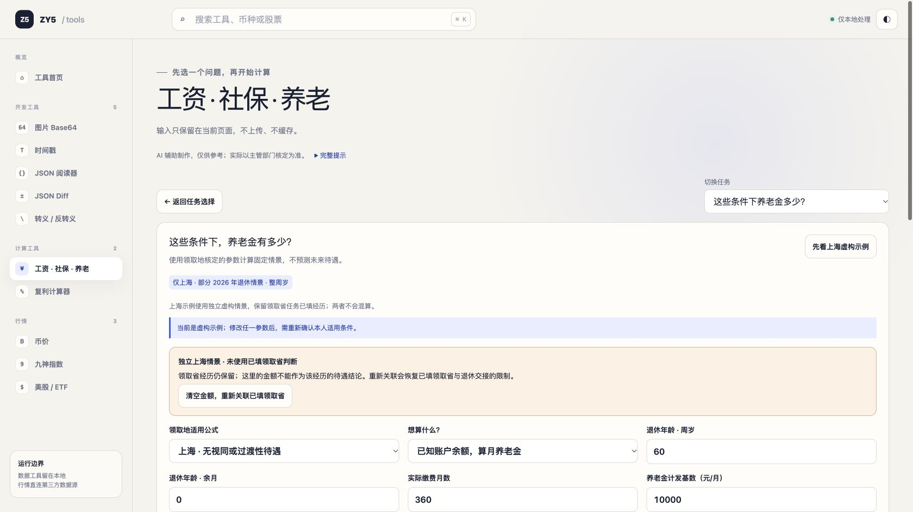

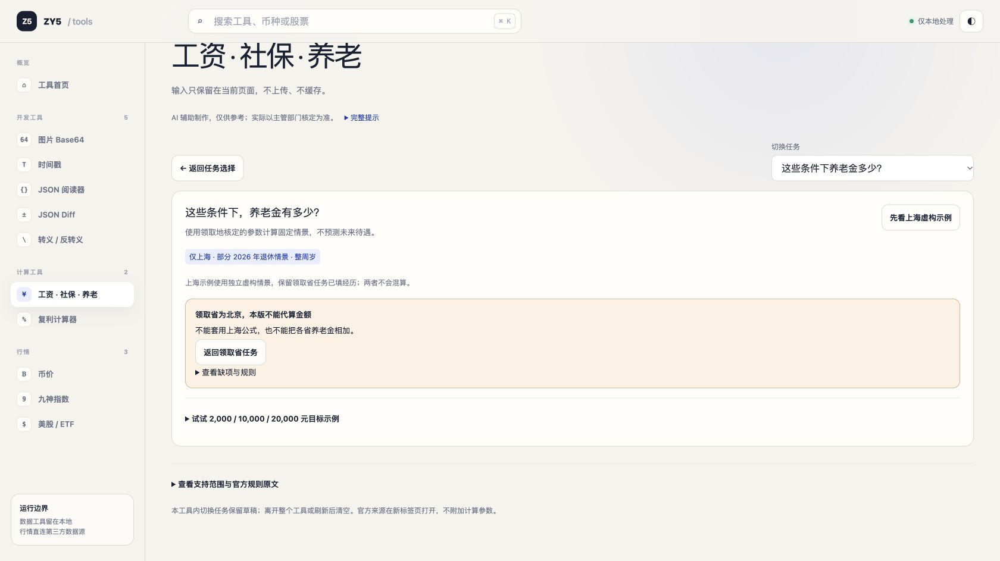
