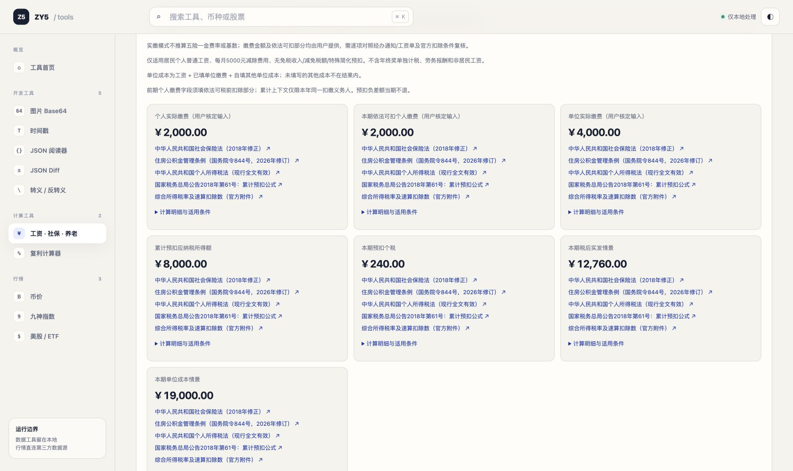
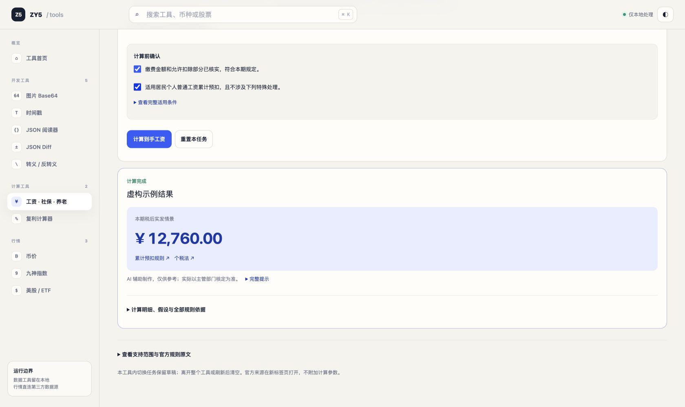
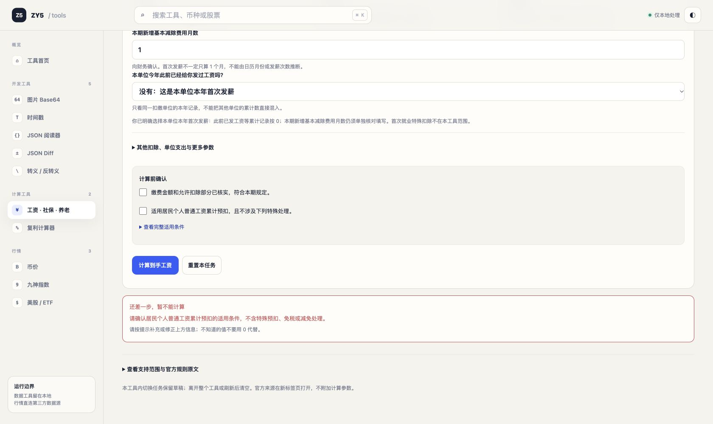
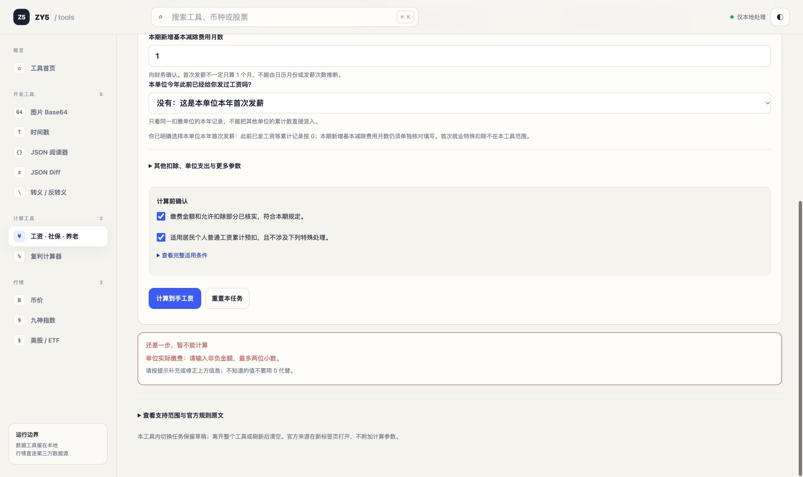
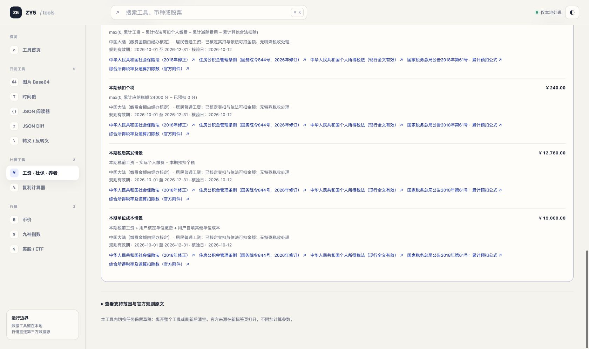
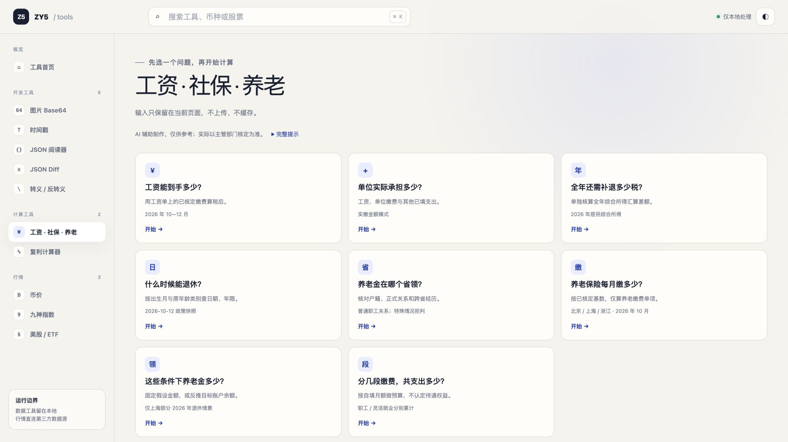
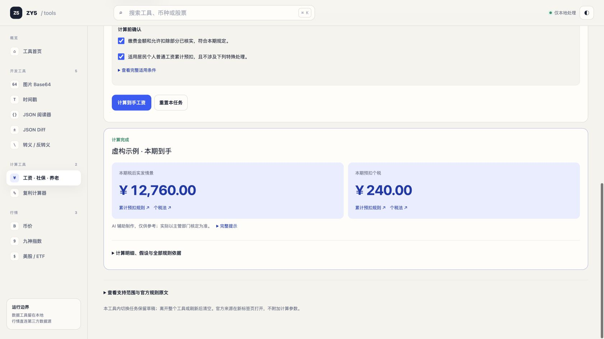
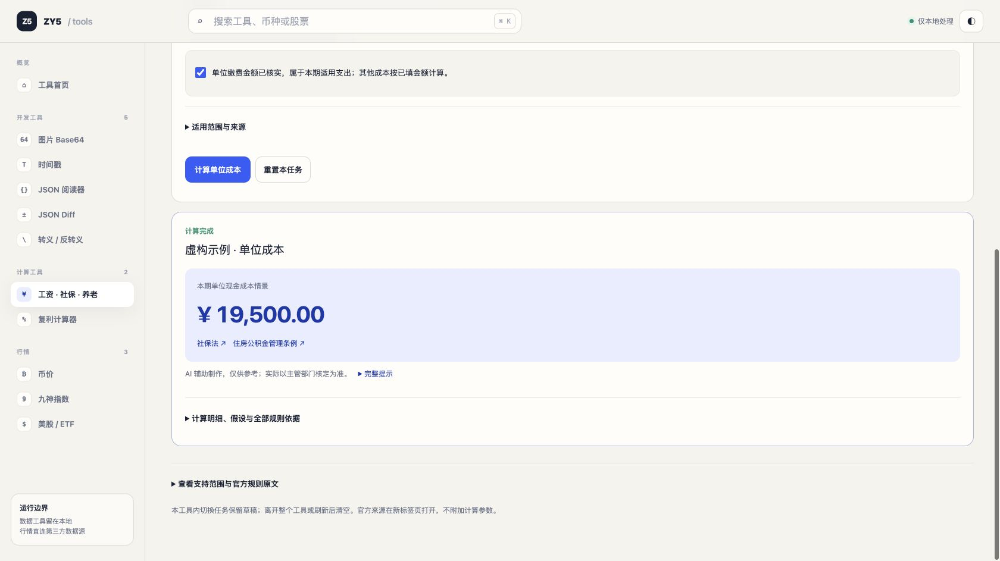
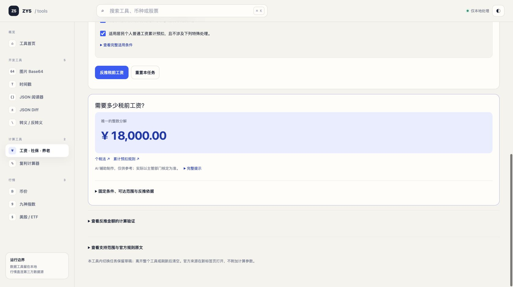

# 工资新手任务 UX 审核

日期：2026-10-12。审核者为独立 AI，采用模拟新手的启发式走查；不声称是真实用户调研。仅使用网页的一键虚构数据。未预读实现代码或既有验收脚本，未修改实现。

**最新结论：最终 targeted 回归通过，本工资新手任务范围内 P1/P2 已清零。** 下文保留前两轮实测历史；最终结果与路由判断更正见文末。另有 P3 文案/重置定位建议，不构成发布阻断。

## 任务与计数

任务：不懂个税的新访客用一键虚构工资例子完成计算，指出输入、最终到手工资和单位成本。点击只统计任务中的页面点击；滚动单独统计，浏览器导航、截图与观察不计。桌面 Chrome，1680×999 页面截图。

## 改版前：不通过，P1 发布阻断

自主路径：

1. 打开 `http://localhost:3000/#labor`，实际呈现工具首页。点击左栏「工资 · 社保 · 养老」（点击 1）。
2. 首屏先看到大标题、两行警示、工作区选项卡和密集三列表单。「一键虚构示例」位于表单右上角，点击（点击 2）。
3. 工资等输入更新，页面未滚动，也没有显著完成提示。向下滚一屏（滚动 1），见表单后半段与「计算结果」，但结果首先展示规则文字及三张输入复述卡。
4. 再向下滚一屏（滚动 2），看到单位成本 19,000 元，但已越过到手工资卡。
5. 向上回滚半屏（滚动 3），在第二排右侧找到「本期税后实发情景」12,760 元，与下一排的单位成本同时可见。

完成任务合计：**2 次点击、3 次滚动**；从工资页内开始为 1 次点击、3 次滚动。没有手工输入，没有再次点击计算按钮。

识别出的虚构输入：税前工资 15,000 元，个人社保公积金实缴及可税前扣部分各 2,000 元，单位缴费 4,000 元；其他扣除/额外单位成本均 0；此前累计各项 0、本期新增减除月数 1。显示结论：本期预扣个税 240 元、到手工资 12,760 元、单位成本 19,000 元。本审核只核验界面可辨识性，不以能生成这些金额代替可用性通过。

### 独立问题分级

- **P1：最终结论与输入复述无优先级。** 结果第一排为个人实际缴费、依法可扣部分、单位实际缴费，均属用户输入。到手工资位于第二排右侧，单位成本独占第三排；七张卡样式一致，无法一眼判断哪两项是任务答案。
- **P1：执行后的反馈和位置不清楚。** 「一键虚构示例」已自动完成计算，但仍停在表单顶部，缺少显著完成状态/结论定位。首屏看不到答案，必须自行探索；按钮名也未说明同时计算。
- **P2：法规重复挤占结果阅读空间。** 每张结果卡重复同一组五个法规链接，共 35 个链接；警示/适用条件在输入区与结果区重复。大段法规比任务答案更显著，用户必须过滤大量相似文字。
- **P2：输入分类不足。** 必填累计背景、个人缴费、税前扣除、可选额外成本横向混排；「已核验地区 / 人群」看似地区选择，却只有「已核定实缴金额」一项。新手难判断准备什么数据及哪些是可选。
- **P2：深链接进入首页。** 本次新标签首次访问 `#labor` 仍显示工具首页，需要另一次点击；记录为观察，不据此推断所有访问均复现。
- **P3：术语增加解释成本。** 「本期税后实发情景」比「本月到手工资（估算）」更难对应任务，细节与结论的标题也缺少区分。

## 改版后第一轮独立复测

仍使用 fresh Chrome 新标签，不预读实现或点击脚本。首先自主执行原任务，再检查编辑、错误恢复、重置和返回。所有数字仍为虚构。

| 指标 | 改版前 | 改版后第一轮 |
| --- | --- | --- |
| 到到手工资主结论 | 2 点击、3 滚动（同时找成本） | 3 点击、0 滚动 |
| 原任务两项结论均找到 | 2 点击、3 滚动 | 4 点击、2 滚动 |
| 工具内到到手主结论 | 1 点击、3 滚动 | 2 点击、0 滚动 |

新版路径：首次 `#labor` 仍显示首页 → 左栏工具（点击 1）→「工资能到手多少？」（点击 2）→「先看虚构示例」（点击 3）。页面自动定位结果，清楚显示「计算完成」「虚构示例结果」及紫色主卡 12,760 元。为了完成原任务还需指出单位成本，我自然选择展开「计算明细、假设与全部规则依据」（点击 4），往下滚一屏再半屏（滚动 2 次），在明细末端读到 19,000 元。工具调用中有一次语义定位失败，未执行页面操作，不计用户点击。

这次样例主流程的点击数多 1 次，但加入的是清楚的任务选择，省去了寻找主答案的滚动；因此工资单目标明显改善。双目标仍需展开大量明细；用户也可自行选择另一个单位成本任务，本次未把尚未实际使用的替代路径当作计数结果。

### 状态与错误分支

- **修改示例：通过。** 将工资 15,000 改为 18,000，旧结果、虚构示例标识和两项确认立即清除。直接点击计算时聚焦错误区，要求重新确认普通工资适用条件，没有沿用示例核定。示例后的两项复选框未增加数量，下一步可识别。
- **单位缴费未知：P1。** 其他示例背景保留，把单位缴费留空，再确认两项条件并点击「计算到手工资」，得到「单位实际缴费：请输入非负金额，最多两位小数」，且提示未知不能填 0。到手工资不使用单位缴费，新手只知道个人工资单时却被迫提供它；这会彻底阻断任务，不能降格为 P2 多一个字段。已反馈主代理，待拆分后再验。
- **重置：通过，P3 体验余项。** 1 次重置清空金额、月数、累计背景选择、确认和错误，无残留结果；仍停在表单下方，开始填写需要回滚，可考虑定位第一字段。
- **空表单提交：通过基本错误反馈。** 1 次提交不出金额，提示先确认本单位此前是否发薪、未知不能按 0。错误区可見且聚焦；没有逐字段跳转，是 P3 改进项。
- **错误后再用示例、重复计算：通过。** 再点示例恢复清楚标识和 12,760 元；重复计算数值不变，没有累加或重复结果区。
- **返回/重入：通过。** 返回任务选择 1 点击、再进工资 1 点击，保留示例草稿与标识，符合页尾承诺；导航聚焦任务区。

### 原问题关闭情况

| 原问题 | 本轮判定 | 证据/残留 |
| --- | --- | --- |
| P1 结论与输入复述同级 | 关闭（到手主任务） | 紫色单一主卡，其他输入/中间值收起 |
| P1 一键后无反馈/定位 | 关闭 | 计算完成、虚构示例结果、自动滚动聚焦 |
| P2 法规重复占主界面 | 主界面关闭，明细中残留 P2 | 主卡仅两条短来源；展开明细仍每项重复五链接，第二目标成本埋在末端 |
| P2 输入分类不足 | 部分关闭，剩余 P1 单位缴费依赖 | 任务选择、逐字段帮助、其他参数折叠明确；累计背景改为明确选择 |
| P2 `#labor` 首访首页 | 残留 | fresh 标签再次观察到首页 |
| P3 税后实发情景术语 | 残留 P3 | 任务标题为到手工资，卡片标签仍为税后实发情景，已有足够上下文 |

**本轮结论：示例到手工资可用性通过；真实录入（本次仍用虚构数据模拟）仍被未知单位缴费阻断，整体工资新手任务暂不放行。** 本轮未把示例成功等同所有实际录入可用。待单位缴费依赖修复，针对该阻断复验。

## 最终 targeted 回归：通过

在工资计算与单位成本拆分后，再开 fresh Chrome 标签从 `http://localhost:3000/#labor` 独立操作，未读取实现。

### 路由判断更正

新标签首次自动 AX 快照仍呈现首页，但本次没有立刻点击左栏，而是取后续 AX 与截图观察加载完成的页面；无需任何用户点击，页面已经自动显示劳动任务列表。此前两轮在首个快照后立即点击，证据不足以证明稳定路由错误；撤回该 P2。基线点击数保留为实际已发生操作，不把它解释成修复前必须的最短路径。

### 最终自然路径与计数

1. 页面自动进入任务选择；点击「工资能到手多少？」（点击 1）。表单中没有单位缴费或其他单位支出，只需工资、个人缴费和个税背景。
2. 点击「先看虚构示例」（点击 2），自动定位两项清楚的结论：本期到手 12,760 元、本期预扣个税 240 元。**到手目标 2 点击、0 滚动。**
3. 为查看单位成本，向上滚一屏（滚动 1），点击「返回任务选择」（点击 3）、「单位实际承担多少？」（点击 4）和「先看虚构示例」（点击 5），自动定位单位现金成本 19,500 元。输入为税前 15,000、单位缴费 4,000、其他单位支出 500；它是独立示例，和旧版 0 元其他成本得出 19,000 的基线不同，不能把两者视作金额回归。

**最终双目标实测：5 点击、1 滚动。** 相比改版前实测 2 点击、3 滚动，增加的是有意义的任务选择与返回，两个目标各自直达主卡，不再需要从法规和中间值里找结论。不要仅用总点击更少判定更好。工资页内示例仍只需 1 点击。

### 单位依赖、编辑与反推验证

- 回到工资任务，把示例税前 15,000 改为 18,000，旧结果和两项核定确认再次立即撤销。
- 重新确认虚构的普通工资及个人缴费条件后计算，显示到手 **15,670 元**、预扣个税 **330 元**。全过程未要求输入单位缴费，也未把单位成本作为工资结论。此前“未知单位缴费无法计算到手” **P1 关闭**。
- 切换「已知目标到手，反推税前」后旧结果及确认失效。目标改为 15,670，重新确认后显示所需税前 **18,000 元**。反推同样无需单位资料。
- 前轮已验证重置、空表单错误、错误恢复、重复计算及返回保留草稿；本轮再次覆盖返回重入与编辑失效。范围为模拟新手工资任务，不据此推及未走查的全部税务或其他工具。

### 最终分级

| 项目 | 最终判定 |
| --- | --- |
| P1 主结论埋没、无完成反馈 | 已关闭，自动定位高亮主卡 |
| P1 只算到手却强制单位资料 | 已关闭，正算/反推实测均无该依赖 |
| P2 输入混排 | 已关闭，工资/单位成本独立任务，可选参数折叠 |
| P2 主路径受重复法规挤占 | 已关闭，两个主任务均无须打开算法明细；明细长度本身不再列为 P2 |
| P2 深链接首页 | 撤回：最终无点击观察确认加载后自动进入任务页，旧证据未排除加载过程 |
| P3 重置后第一字段定位 | 可改进，前轮观察仍有回滚成本 |
| P3 结果术语 | 卡片仍用“税后实发情景”；反推“唯一的整数分解”不易懂，可改“所需税前工资（精确到分）”；标题和金额足以理解任务结论 |

**可用性结论：本次独立模拟新手任务通过；工资范围剩余 P1=0、P2=0，P3 不阻断。** 此结论建立在实际完成示例、修改后的计算、反推和独立单位成本任务上，不只因为算法生成了金额。

